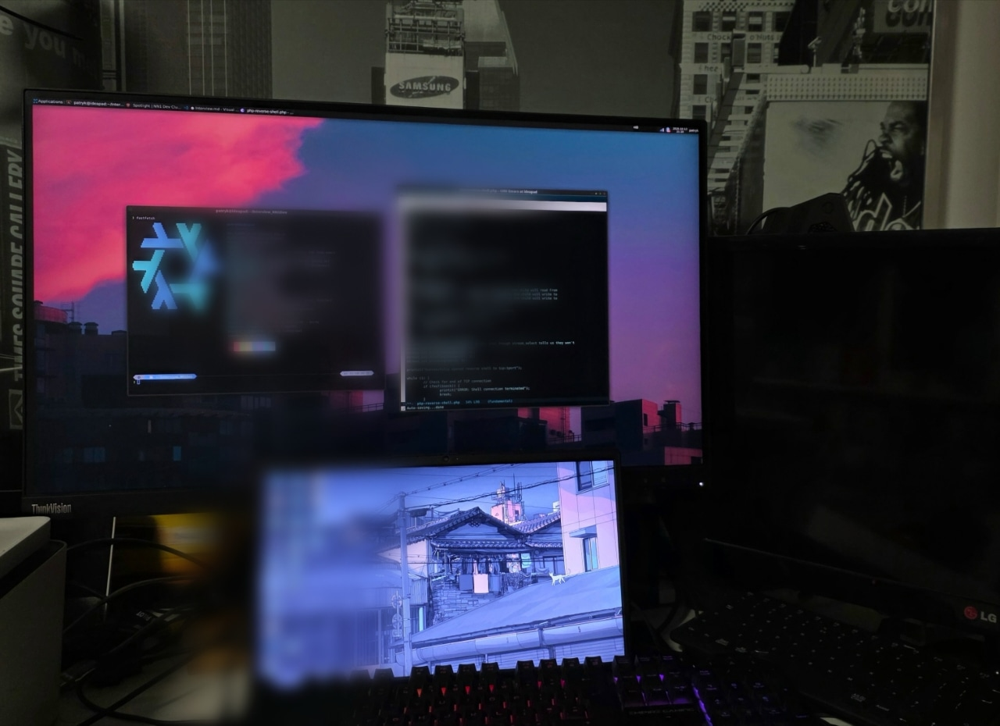

## Who are you and what do you do?

I'm Patryk. I recently graduated with a BSc in Ethical Hacking & Cybersecurity from Coventry University, and I'm a member of Hackerspace Trójmiasto and Tricity Linux User Group. I'm a pen tester with a particular interest in the red team side of cybersecurity, where I do web application pen-testing, system pen-testing, reverse engineering and binary exploitation.

## What first got you into tech?

I've always been a tech geek, and developing my IT skills pulled me deeper into the field. I wanted to understand the lower-level aspects of computing and to see how I might discover a critical vulnerability.

## What does your typical working day look like?

If I'm in Poland, I commute to Hackerspace Trójmiasto and spend the day working on projects with other members. Recently that has included reverse-engineering a Bluetooth LE protocol to control a gimbal. Occasionally we try new activities I find valuable, such as amateur radio.

If I'm at home, I grab a fresh-brewed coffee, open up my laptop and work on whatever project I've started, documenting it as I go.

## What's your setup? Software and hardware. Pictures welcomed!

I run a basic setup with my own server instance, where I self-host services like Forgejo (Git), Matrix and Nextcloud. Self-hosting gives me full ownership of my data.

### Hardware

- **Laptop:** Lenovo IdeaPad 3 14ADA6 (20GB RAM, AMD Ryzen 3 3250U)
- **Self-hosting server:** Lenovo ThinkCentre M910q (8GB RAM, Intel i5-6500T)

### Software

- **Laptop OS:** NixOS
- **Terminal:** Alacritty
- **Shell:** [Oh my ZSH](https://ohmyz.sh/)
- **Desktop environment:** XFCE, KDE and sometimes Sway for productivity
- **Text editor:** GNU Emacs with Evil configurations, VSCode and PyCharm
- **Web browser:** LibreWolf, Brave
- **Server OS:** Ubuntu Server LTS

## What's the last piece of work you feel proud of?

My dissertation project on Android malware detection using neural networks, which I worked on this year. I challenged myself to build a machine learning model (a bidirectional GRU, which reached 99% accuracy on about 15,000 APK samples) and then implement it via a Python helper script that uses the Androguard library to gather static features from APKs.

## What's one thing about your profession you wish more people knew?

Pentesting is far less about "hacking in" than about methodology and reporting. Most of the value is in clearly documenting findings, how to reproduce them, and how to fix them. An exploit that nobody can act on is worth very little. Real-world breaches also usually come from boring things like weak credentials, unpatched software and misconfigurations, not zero-days.

## Share with others something worth checking out. Not necessarily tech related. Shameless plugs welcomed.

- **Local hackerspaces:** a great place to learn by building things with other people, like Hackerspace Trójmiasto.
- **Self-hosting:** try Forgejo, Matrix or Nextcloud on an old mini PC.
